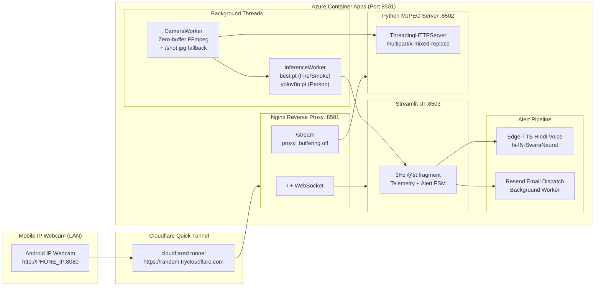

<p align="center">
  
  
  
  
  
  
  
  
  
</p>

<h1 align="center">HazardLens</h1>

<p align="center">
  <strong>Enterprise NVR & Real-Time AI Threat Detection Console</strong><br/>
  Dual YOLOv8 fire/smoke + crowd inference pipeline · Native MJPEG streaming at 12-15 FPS · Hindi neural voice alerts · Single-port Nginx reverse proxy · Zero-cost Azure deployment
</p>

<p align="center">
  <a href="https://hazardlens.agreeablesky-0ffa5750.centralindia.azurecontainerapps.io">Live Demo</a> · 
  <a href="#system-architecture">Architecture</a> · 
  <a href="#local-development">Dev Setup</a> · 
  <a href="#connecting-a-live-phone-camera-via-cloudflare-tunnel">Camera Guide</a> · 
  <a href="#cloud-deployment">Deploy</a>
</p>

> **Cold-start note:** The live demo runs on Azure Container Apps with scale-to-zero (`--min-replicas 0`). If the app has been idle, the first request triggers a container cold start that takes ~20-25 seconds. Subsequent loads are instant.

---

## System Architecture



**Data flow inside the container:**

1. **CameraWorker** (daemon thread) connects to the Cloudflare tunnel URL using OpenCV's C++ FFmpeg backend with zero-buffer flags (`fflags;nobuffer|flags;low_delay|probesize;32768|analyzeduration;0`, `CAP_PROP_BUFFERSIZE=1`). Falls back to persistent `requests.Session` hitting `/shot.jpg` with Keep-Alive if the MJPEG stream drops.
2. **InferenceWorker** (daemon thread) pulls raw frames from `CameraWorker` by sequence number and runs twin YOLOv8 models (`best.pt` for fire/smoke at `conf >= 0.85`, `yolov8n.pt` for person counting) at `imgsz=320`. Inference never blocks frame ingestion.
3. **Built-in MJPEG server** (`ThreadingHTTPServer` on port `8502`) reads annotated frames from `CameraWorker` + `InferenceWorker` and streams `multipart/x-mixed-replace` JPEG at ~15 FPS. The browser renders an `` tag pointed at `/stream` — zero Streamlit reruns.
4. **Nginx** (port `8501`) routes `/` and WebSocket upgrades to Streamlit (`127.0.0.1:8503`) and `/stream` to the MJPEG server (`127.0.0.1:8502`) with `proxy_buffering off`.
5. **1Hz telemetry fragment** (`@st.fragment(run_every=1.0)`) updates the alert state machine, triggers Hindi voice alerts via Edge-TTS, and dispatches email alerts via Resend.

---

## Key Engineering Decisions

### Decoupled Native MJPEG Streaming (12-15 FPS)

Live video rendering was moved completely outside Streamlit's script-rerun loop. A dedicated `ThreadingHTTPServer` serves `multipart/x-mixed-replace` MJPEG frames that the browser renders natively via ``. This eliminated UI dimming, WebSocket queue stalls, frame freezes, and DOM shift artifacts (duplicate camera headers) that plagued the previous `st.image()` / `@st.fragment(run_every=0.10)` approach.

### Single-Port Nginx Reverse Proxy

Bridges Streamlit (internal `8503`) and the MJPEG server (internal `8502`) under one public HTTPS ingress port (`8501`). The `MJPEG_STREAM_URL=/stream` environment variable tells the Streamlit frontend to request video from the same origin, eliminating CORS and mixed-content issues in cloud deployments behind Azure Container Apps or Cloudflare.

### Zero-Buffer Ingestion

Replaced naive HTTP polling with low-delay FFmpeg streaming via `cv2.VideoCapture(url, cv2.CAP_FFMPEG)` configured with `fflags;nobuffer|flags;low_delay|probesize;32768|analyzeduration;0` for sub-second latency over Cloudflare tunnels. A persistent `requests.Session` with `Connection: keep-alive` hitting `/shot.jpg` serves as a resilient fallback when the MJPEG stream temporarily drops.

### NVR Operator UX

- Non-cropping `object-fit: contain` viewport preserving the full HUD (`REC · CAM 01 · timestamp`, `CAM X.X FPS | YOLO XXms`)
- Per-camera native Browser Fullscreen API toggle (`[ ⛶ ]`) without reloading the stream
- High-visibility pulsing crimson `🔇 SILENCE ALERT` button with automatic 3-second grace-period audio shutoff when hazards clear

### Lean Headless Container

CPU-only PyTorch wheels, explicit removal of GUI `opencv-python` (pulled transitively by `ultralytics`) in favor of `opencv-python-headless` with build-time `import cv2` verification, non-root `hazarduser` execution, Windows CRLF stripping for `start.sh`/`nginx.conf`, and `/_stcore/health` container healthcheck.

---

## Connecting a Live Phone Camera via Cloudflare Tunnel

Stream a local Android/iOS IP camera into the cloud-deployed dashboard in 5 steps:

### 1. Start the IP Camera App

Install [IP Webcam](https://play.google.com/store/apps/details?id=com.pas.webcam) (Android) on your phone. Start the server — it shows a URL like `http://<PHONE_IP>:8080`.

**Recommended settings for smooth cloud inference:**

| Setting | Value | Why |
|---|---|---|
| Resolution | `640x480` | Keeps JPEG frames small (~30-50 KB) for fast tunnel transfer |
| FPS | `15` | Good lighting maintains steady 12-15 FPS through the tunnel |

### 2. Expose via Cloudflare Quick Tunnel

On a laptop/PC connected to the **same Wi-Fi** as the phone:

```bash
cloudflared tunnel --url http://<PHONE_IP>:8080
```

This outputs a URL like (example) `https://random-subdomain.trycloudflare.com` — no Cloudflare account needed.

### 3. Paste the Tunnel URL

Open the HazardLens dashboard. In the sidebar, paste the tunnel URL into **CAM 01 Stream URL**. You can paste the base URL, `/video`, or `/shot.jpg` — `CameraWorker` normalizes all three:

| Input | Resolved URLs |
|---|---|
| `https://xyz.trycloudflare.com` | `/video` (primary), `/shot.jpg` (fallback) |
| `https://xyz.trycloudflare.com/video` | `/video` (primary), `/shot.jpg` (fallback) |
| `https://xyz.trycloudflare.com/shot.jpg` | `/video` (primary), `/shot.jpg` (fallback) |

### 4. ARM the System

Click **ARM SYSTEM**. The `CameraWorker` connects via zero-buffer FFmpeg streaming, and within 1-2 seconds the live feed appears on CAM 01 with YOLO detections and HUD overlay.

### 5. Troubleshooting

| Symptom | Cause | Fix |
|---|---|---|
| 4-6 FPS instead of 12+ | Phone in dark/low-light — camera increases exposure time, dropping FPS | Move to better lighting or point a lamp at the scene |
| ~20s delay on first load | Azure Container Apps cold start (scale-from-zero) | Wait for initial wake-up; subsequent loads are instant |
| Feed stops after closing `cloudflared` | Tunnel URL expires when the process stops | Restart `cloudflared tunnel --url ...` and paste the new URL |
| `CONNECTING` badge stays indefinitely | Phone and laptop on different Wi-Fi networks | Ensure both are on the same LAN before running `cloudflared` |

---

## Environment Variables Reference

| Variable | Purpose | Required | Default / Example |
|---|---|---|---|
| `RESEND_API_KEY` | Resend API key for email alert dispatch | Optional | `re_xxxxxxxxx` |
| `HAZARDLENS_FROM_EMAIL` | Sender address for alert emails | Optional | `onboarding@resend.dev` |
| `HAZARDLENS_ADMIN_EMAIL` | Recipient address for alert emails | Optional | `admin@example.com` |
| `HAZARDLENS_OPERATOR_PIN` | PIN to unlock ARM/DISARM/SILENCE controls | Optional | `1234` |
| `HAZARDLENS_MODEL_SHA256` | SHA-256 hash of `best.pt` for integrity verification | Optional | `18d47a2e...` |
| `HAZARDLENS_CAM_USER` | Default camera HTTP auth username | Optional | `cam01` |
| `HAZARDLENS_CAM_SECRET` | Default camera HTTP auth password | Optional | `your_cam_secret` |
| `HAZARDLENS_CAM_PORT` | Default port for LAN camera discovery | Optional | `8080` |
| `HAZARDLENS_DRONE_URL` | Direct camera URL override (skips LAN scan) | Optional | _(empty)_ |
| `MJPEG_PORT` | Internal MJPEG server port | Optional | `8502` |
| `MJPEG_STREAM_URL` | Stream endpoint URL used in `` | Optional | `http://localhost:8502/stream` (local) or `/stream` (Docker) |
| `YOLO_CONFIG_DIR` | Ultralytics config/cache directory | Optional | `/tmp/ultralytics` (Docker) |

---

## Local Development

### Option A: Native Python

```bash
git clone https://github.com/tusharsingh-sde/HazardLens.git
cd HazardLens

python -m venv venv
# Windows: .\venv\Scripts\Activate.ps1
# Linux/macOS: source venv/bin/activate

pip install -r requirements.txt

cp .env.example .env
# Edit .env with your RESEND_API_KEY and HAZARDLENS_ADMIN_EMAIL

streamlit run app.py
```

Opens at `http://localhost:8501`. MJPEG server runs on `8502` (accessed directly since there's no Nginx locally).

### Option B: Docker (Production Parity)

```bash
docker build -t hazardlens .
docker run --rm -p 8501:8501 --env-file .env hazardlens
```

Single port `8501` — Nginx routes `/` to Streamlit and `/stream` to the MJPEG server internally. Same behavior as the cloud deployment.

### Running Tests

```bash
# Full test suite (59 tests)
pytest -v

# Headless Streamlit runtime test
python -c "from streamlit.testing.v1 import AppTest; at = AppTest.from_file('app.py', default_timeout=30).run(); assert not at.exception; print('OK')"
```

---

## Cloud Deployment

HazardLens is packaged as a self-contained Docker image exposing a single HTTP/WebSocket port (`8501`) via an embedded Nginx reverse proxy, so it can be deployed on any container platform (Azure Container Apps, Google Cloud Run, Fly.io, AWS ECS, etc.).

Below is a reference **zero-cost deployment** using GitHub Container Registry (GHCR) and Azure Container Apps (Consumption Plan).

### Prerequisites
- Docker installed locally
- GitHub Personal Access Token (PAT) with `write:packages` scope
- [Azure CLI](https://learn.microsoft.com/en-us/cli/azure/install-azure-cli) authenticated via `az login`

### 1. Build & Push to a Container Registry (GHCR)

From the repository root:

```bash
export GITHUB_USER="<YOUR_GITHUB_USERNAME>"
export IMAGE="ghcr.io/${GITHUB_USER}/hazardlens:v1"

docker build -t "$IMAGE" .

echo "<YOUR_GITHUB_PAT>" | docker login ghcr.io -u "$GITHUB_USER" --password-stdin
docker push "$IMAGE"
```

> **Tip:** Set the package visibility to **Public** under `GitHub -> Profile -> Packages -> hazardlens -> Package Settings` so your cloud provider can pull the image without registry credentials. (For private images, pass `--registry-server`, `--registry-username`, and `--registry-password` during deployment.)

### 2. Provision Azure Infrastructure (Skip if Reusing Existing)

```bash
export RESOURCE_GROUP="hazardlens-rg"
export LOCATION="centralindia" # Choose the region closest to your cameras
export ENV_NAME="hazardlens-env"

az group create --name "$RESOURCE_GROUP" --location "$LOCATION"

az containerapp env create \
  --name "$ENV_NAME" \
  --resource-group "$RESOURCE_GROUP" \
  --location "$LOCATION"
```

### 3. Deploy to Azure Container Apps

```bash
az containerapp create \
  --name hazardlens \
  --resource-group "$RESOURCE_GROUP" \
  --environment "$ENV_NAME" \
  --image "$IMAGE" \
  --target-port 8501 \
  --ingress external \
  --cpu 2.0 \
  --memory 4.0Gi \
  --min-replicas 0 \
  --max-replicas 1 \
  --secrets \
    resend-api-key="<YOUR_RESEND_API_KEY>" \
    cam-secret="<YOUR_CAM_SECRET>" \
    operator-pin="<YOUR_OPERATOR_PIN>" \
  --env-vars \
    RESEND_API_KEY=secretref:resend-api-key \
    HAZARDLENS_CAM_SECRET=secretref:cam-secret \
    HAZARDLENS_OPERATOR_PIN=secretref:operator-pin \
    HAZARDLENS_FROM_EMAIL="onboarding@resend.dev" \
    HAZARDLENS_ADMIN_EMAIL="<YOUR_ALERT_EMAIL>" \
    HAZARDLENS_CAM_USER="cam01" \
    HAZARDLENS_CAM_PORT="8080"
```

Retrieve the live HTTPS URL once provisioning completes:

```bash
az containerapp show \
  --name hazardlens \
  --resource-group "$RESOURCE_GROUP" \
  --query properties.configuration.ingress.fqdn \
  -o tsv
```

### Scaling & Resource Configuration Rationale

| Flag | Value | Why |
|---|---|---|
| `--min-replicas 0` | Scale to zero when idle | Stays within Azure's monthly free grant (180,000 vCPU-s / 360,000 GiB-s) with zero idle cost. Close the browser tab after sessions so the persistent `/stream` connection does not prevent scale-down. |
| `--max-replicas 1` | Single replica only | `mjpeg_state["worker"]` is held in-memory per replica. Multiple replicas would split UI and `/stream` requests across unsynchronized instances. |
| `--cpu 2.0 --memory 4.0Gi` | Dual YOLOv8 headroom | Two YOLOv8 models running concurrently on CPU-only PyTorch alongside FFmpeg + Nginx. Prevents CPU throttling and OOM kills during live inference. |

---

## Detection Thresholds

All constants are defined at the top of [`app.py`](app.py):

| Parameter | Value | Constant |
|---|---|---|
| Fire/Smoke confidence | `0.85` | `FIRE_CONF_THRESHOLD` |
| Crowd limit | `5` persons | `CROWD_THRESHOLD` |
| Frame skip | `4` | `FRAME_SKIP` |
| Email cooldown | `120s` | `EMAIL_COOLDOWN_SEC` |
| Audio cooldown | `120s` | `AUDIO_COOLDOWN_SEC` |
| Alert clear grace | `3.0s` | `ALERT_CLEAR_GRACE_SEC` |
| Silence duration | `60s` | `SILENCE_DURATION_SEC` |

---

## Project Structure

```
HazardLens/
├── alerts/
│   ├── __init__.py
│   └── email_alerts.py          # Resend API queued background worker with retry
├── config/
│   ├── paired_cameras.json      # Live camera registry (gitignored)
│   └── paired_cameras.json.example
├── tests/
│   ├── test_audio_alerts.py     # Looping audio, silence/disarm state resets
│   ├── test_email_alerts.py     # Email cooldown, retries, missing env
│   └── test_security.py         # SSRF, PIN auth, model SHA-256, camera registry
├── utils/
│   ├── __init__.py
│   └── security.py              # URL validation, PIN check, model hasher, LAN scanner
├── .streamlit/
│   └── config.toml              # Streamlit server config (headless, CORS, XSRF)
├── app.py                       # Main application (2240 lines) — UI, workers, alerts
├── best.pt                      # Custom-trained fire/smoke YOLOv8 model
├── yolov8n.pt                   # Pre-trained person detection model
├── nginx.conf                   # Reverse proxy config (single-port, WebSocket, MJPEG)
├── start.sh                     # Container entrypoint (Nginx + Streamlit)
├── Dockerfile                   # Production image (python:3.12-slim, non-root)
├── docker-compose.yml           # One-command local Docker deployment
├── requirements.txt             # Python dependencies
├── .env.example                 # Environment variable template
└── .dockerignore                # Excludes secrets, venv, tests, .mp3 from image
```

---

## Author

**Tushar Singh**

[](https://github.com/tusharsingh-sde)
[](https://hazardlens.agreeablesky-0ffa5750.centralindia.azurecontainerapps.io)

## License

MIT — see [LICENSE](LICENSE) for details.
